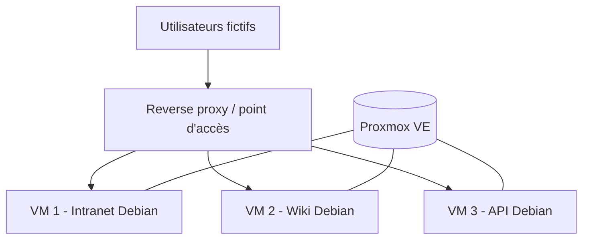
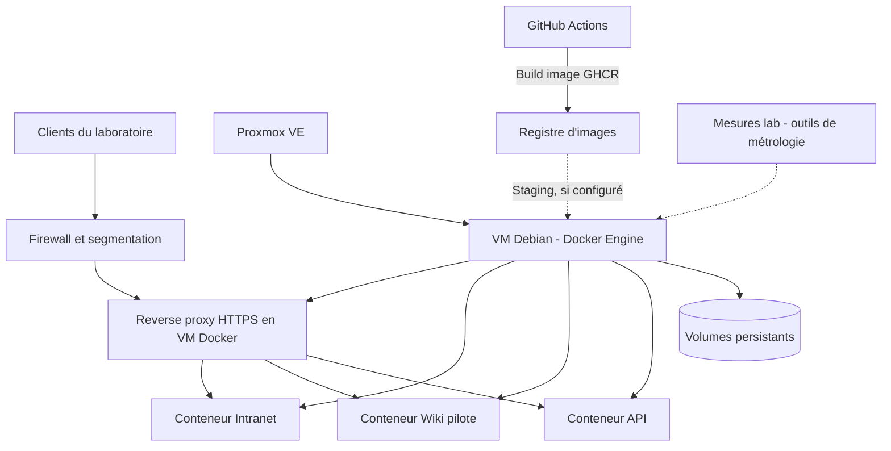

# 02 — Architecture de référence

## Avant : machines virtuelles indépendantes

## Après : consolidation de conteneurs dans une VM

## Segmentation envisagée
- Zone d'administration : SSH sur VM Docker et consoles Proxmox, accessible seulement aux administrateurs autorisés.
- Zone services : trafic applicatif depuis le reverse proxy, réseaux Docker internes par application.
- Zone tests : clients factices de benchmark, accès limitée aux services pilotes.
- Sauvegardes : support distinct de la VM applicative, test de restauration.

Pas d'accès entrant Internet sur Proxmox, la base de données, Docker API ou les consoles administrateur.

## Principes
1. **Docker dans une VM** et non sur l'hyperviseur Proxmox.
2. Conteneurs non root, capacités minimales, ports locaux par défaut, données persistantes, TLS au reverse proxy.
3. Staging isolé de tout environnement réel de mairie.
4. Un service migré à la fois, validation fonctionnelle puis mesure, conservation d'un chemin de retour.
5. Ne pas combiner consolidation et modification fonctionnelle : mêmes versions/configurations avant et après lorsque possible.

## Matrice de flux fictive
| Source | Destination | Protocole | But | Autorisation |
|---|---|---|---|---|
| VM d'administration | VM Docker | SSH/22 | Exploitation | Oui, contrôlé |
| Reverse proxy | Portail pilote | TCP/8080 | Application | Oui, local/privé |
| Utilisateurs de test | Reverse proxy | HTTPS/443 | Accès | Oui |
| Utilisateurs de test | Docker API | TCP/2375 | Administration | Non |
| Internet | Hôte Proxmox | TCP/8006 | Console | Non |
| GitHub runner | VM staging | SSH/22 | Déploiement si activé | Oui, contrôle strict |

## Ce qui reste à décider
Bridge Proxmox, plans IP *fictifs*, stratégie DNS interne, matrice firewall, stockage et sauvegardes : validation après disponibilité du laboratoire.
