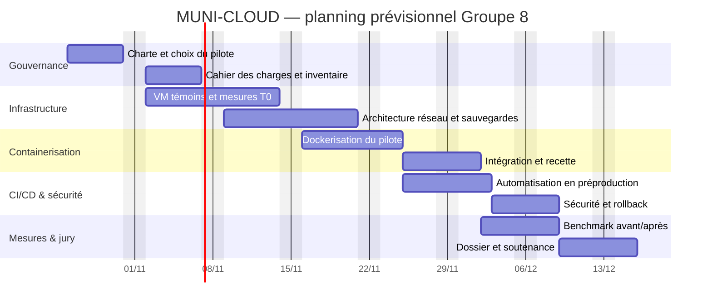

# 03 — Diagramme de Gantt
**Hypothèse non validée :** 8 semaines du 26/10/2026 au 18/12/2026. Décaler les dates lorsque la date de soutenance est connue. Jalons et dépendances à adapter selon le tuteur.

## Jalons
- J1 (fin S2) : cadrage et infrastructure témoin validés.
- J2 (fin S4) : au moins un service Docker équivalent, fonctionnel.
- J3 (fin S6) : pipeline staging validé, stratégie de rollback testée.
- J4 (fin S8) : résultats mesurés, bilan et soutenance.

## Rythme
- Point quotidien asynchrone sur Trello/GitHub (blocages).
- Réunion 2 fois/semaine : 15 à 25 minutes ; compte rendu versionné.
- Revue de sprint en fin de chaque quinzaine ; décisions consignées.

Règle : une tâche ne passe dans « Terminé » qu'avec preuve, test et validation d'un autre membre.
